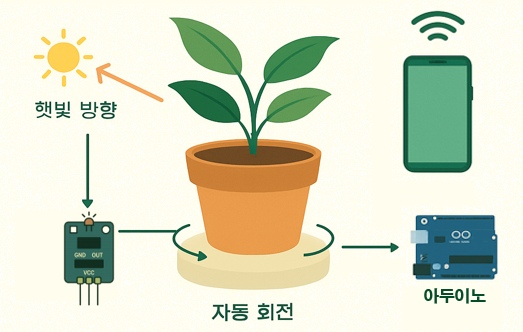
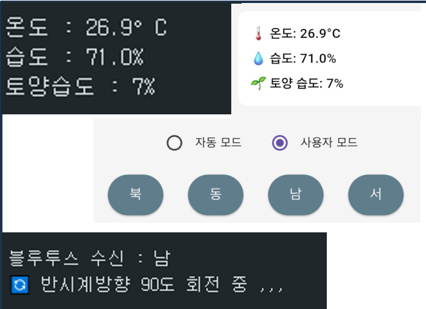

# S.P.I.N 스마트 회전 화분 (Smart Plant Illumination Navigator)

실내에서 햇빛이 한쪽에서만 들어와 식물이 한쪽으로만 자라는 문제를 해결하기 위해 만든 **햇빛 방향을 따라 자동으로 회전하는 화분**입니다.
조도 센서 4개로 빛이 오는 방향을 찾아 DC 모터로 화분을 돌리고, 온도·습도·토양 습도를 **블루투스로 스마트폰 앱에 실시간 전송**합니다.
한남대학교 컴퓨터공학과 캡스톤디자인 프로젝트(2025년 1학기)입니다.


## 프로젝트 정보

| | |
|---|---|
| 기간 | 2025년 1학기 (캡스톤디자인) |
| 팀 | S.P.I.N (5명, 팀장) |
| 분야 | 임베디드(Arduino) / 모바일 앱 연동(Bluetooth LE) / 하드웨어 제작 |
| 발표 | 「아두이노 기반 스마트 회전 화분 시스템」 2025 한국스마트미디어학회 & 한국전자거래학회 춘계학술대회 |

## 만든 이유

아파트·오피스텔 같은 공동주택은 창문 방향이 고정되어 있어 식물이 한쪽에서만 햇빛을 받기 쉽고, 이 때문에 생장이 한쪽으로 치우칩니다. 사람이 직접 화분을 돌려주면 되지만 바쁜 사람에게는 번거롭습니다.
그래서 **사용자가 손대지 않아도 화분이 스스로 빛을 향해 돌아가고**, 필요하면 앱으로 직접 조작할 수 있는 화분을 만들었습니다.



## 주요 기능

- **자동 모드 (기본)**: 동·서·남·북 4방향 조도 센서 값을 주기적으로(13초마다) 비교해 가장 밝은 방향으로 화분을 회전
- **사용자 모드**: 앱에서 동/서/남/북 방향을 직접 선택해 회전, 회전 속도(0~100) 조절
- **환경 모니터링**: 온도·습도(DHT11)와 토양 습도를 1초마다 앱으로 전송
- **안전 동작**: 블루투스 연결이 끊기면 자동 모드로 복귀
- **식물 정보 탭**: 앱에서 식물 정보를 조회/추가/수정



## 동작 구조

```
조도센서 x4 (A0~A3) ─┐
DHT11 온습도 (D10) ──┼─► Arduino Uno ─► L298N 모터 드라이버 ─► DC 모터 ─► 회전판(링 기어)
토양습도센서 (A5) ───┘        │
                              └─ HM-10 (Bluetooth) ◄──► 스마트폰 앱
```

앱 ↔ 아두이노는 줄 단위 텍스트 명령으로 통신합니다.

| 방향 | 메시지 | 설명 |
|---|---|---|
| 앱 → 아두이노 | `MODE:AUTO` / `MODE:MANUAL` | 자동 / 사용자 모드 전환 |
| 앱 → 아두이노 | `DIR:N` `DIR:E` `DIR:S` `DIR:W` | 원하는 방향으로 회전 |
| 앱 → 아두이노 | `SPD:0` ~ `SPD:100` | 회전 속도 |
| 아두이노 → 앱 | `temp:26.9,humid:71.0,soil:7` | 온도(℃), 습도(%), 토양 습도(%) |


### 사용 부품

Arduino Uno, 조도 센서 모듈 4개, DHT11(온습도), 토양 습도 센서, HM-10(Bluetooth), L298N 모터 드라이버, DC 모터 + 외부 건전지 전원, 회전판(링 기어 구조)

### 핀 연결 (`smart_pot.ino` 기준)

| 부품 | 핀 |
|---|---|
| 조도 센서 (동/북/남/서) | A0 / A1 / A2 / A3 |
| 토양 습도 센서 | A5 |
| DHT11 | D10 |
| HM-10 (TX→6, RX←5), STATE | SoftwareSerial(6, 5), D11 |
| 모터 드라이버 ENA / IN1 / IN2 | D9 / D8 / D7 |

> 개발 초기 배선 메모에는 ENA→5, IN1→6, IN2→7로 적혀 있었지만, 최종 코드는 위 표의 핀(ENA 9, IN1 8, IN2 7)을 사용합니다.

## 폴더 구조

```
firmware/
├── smart_pot/                  # 최종 펌웨어 (자동/사용자 모드, 블루투스, 센서 전송)
└── experiments/ldr_test/       # 조도 센서 값 확인용 테스트
docs/images/                    # 사진, 구성도, 앱 화면
```

## 실행해 보기

1. Arduino IDE 라이브러리 관리자에서 **DHT sensor library** (Adafruit)를 설치합니다.
2. 위 핀 표대로 배선하고 `firmware/smart_pot/smart_pot.ino` 를 업로드합니다.
3. HM-10 에 블루투스로 연결할 수 있는 앱에서 `MODE:MANUAL`, `DIR:E` 같은 명령을 보내 동작을 확인합니다. 시리얼 모니터(9600)에서 센서 값과 회전 로그를 볼 수 있습니다.
4. 조도 센서만 먼저 확인하려면 `firmware/experiments/ldr_test` 를 사용하세요.

## 한계와 개선하고 싶은 점

- 회전은 센서로 각도를 읽는 방식이 아니라 **모터를 정해진 시간(90°당 24초) 동안 돌리는 방식**이라, 누적 오차가 생길 수 있습니다. 엔코더나 위치 센서를 추가하면 정확해집니다.
- 회전 중에는 `delay()` 로 대기하기 때문에 그동안 블루투스 명령과 센서 전송이 멈춥니다. `millis()` 기반 상태 머신으로 바꾸면 개선됩니다.
- 토양 습도 보정값(`dryValue`, `wetValue`)이 코드에 고정되어 있어 센서나 흙에 따라 다시 맞춰야 합니다.
- 논문의 향후 과제로 자동 급수, 무선 통신 범위 확대, 외부 기상 정보 반영을 정리했습니다.
- 스마트폰 앱의 소스는 이 저장소에 포함되어 있지 않습니다. (화면 캡처만 `docs/images` 에 있습니다.)

## 참고

- 사용 라이브러리: [DHT sensor library](https://github.com/adafruit/DHT-sensor-library)
- 관련 연구: 김성민 외, 「조도센서를 이용한 빛 추적 시스템」, 한국정보기술학회 2017 하계종합학술대회
