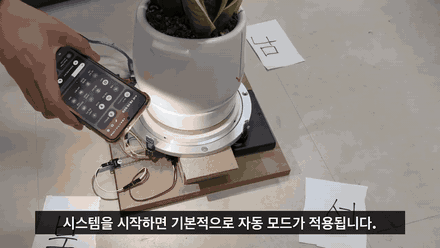
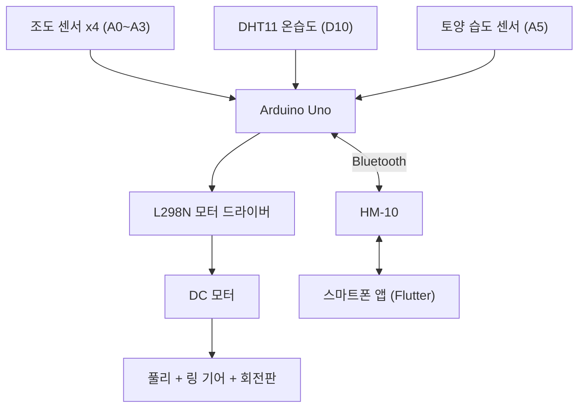
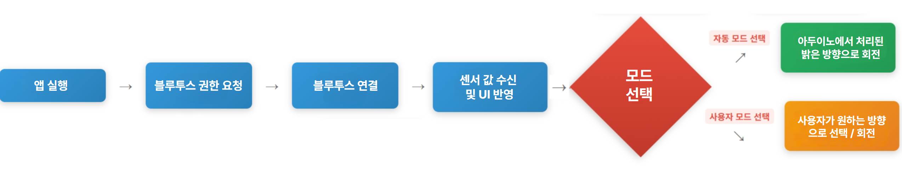
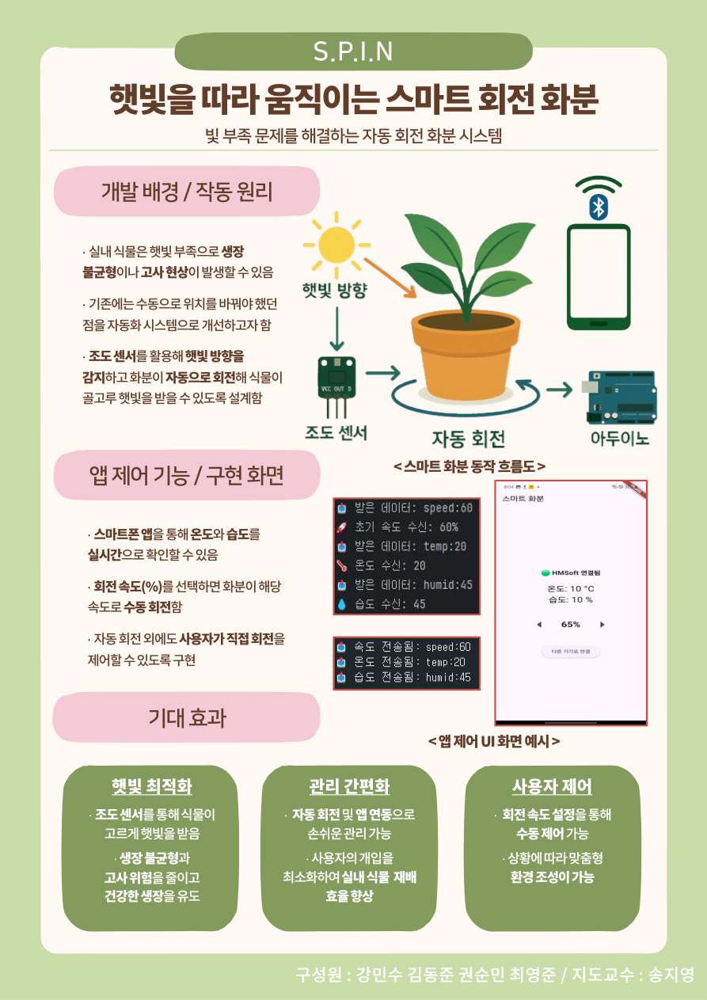

# S.P.I.N 스마트 회전 화분 (Smart Plant Illumination Navigator)

햇빛이 한쪽에서만 들어오는 실내에서도 식물이 골고루 빛을 받도록, **빛이 오는 방향을 찾아 스스로 회전하는 화분**입니다.
조도 센서 4개로 가장 밝은 방향을 찾아 DC 모터로 화분을 돌리고, 온도·습도·토양 습도를 **블루투스로 스마트폰 앱에 실시간으로 전송**합니다.
한남대학교 컴퓨터공학과 캡스톤디자인(2025년 1학기)에서 만들었고, 이 프로젝트로 쓴 논문이 KCI 등재지에 게재되었습니다.


## 시연 영상

[](docs/demo.mp4)

이미지를 누르면 전체 영상을 볼 수 있습니다. 손전등으로 한쪽을 비추면 조도 센서가 빛을 인식해 화분이 그쪽으로 회전하고, 앱에서 온도·습도·토양 습도를 확인하는 모습을 보여줍니다.

컴퓨터공학과 학술제(2025년 6월)에서는 1층에 작품을 전시하고, 찾아오는 방문객에게 시스템을 설명하고 직접 시연했습니다. 조원 모두가 돌아가며 자리를 지켰습니다.

## 프로젝트 정보

| 항목 | 내용 |
|---|---|
| 기간 / 팀 | 2025년 3월 ~ 6월 / S.P.I.N (4명, 팀장) |
| 내 역할 | 하드웨어 구축(모터·풀리·링 기어 제작), 디자인·기능 설계, 재료 탐색·구매, 아두이노 코드 일부 작성 |
| 논문 | 「실내 식물 성장을 위한 자동 회전 기반 스마트 화분 연구」, 스마트미디어저널 14(11), pp.158-165, 2025.11 (KCI 등재, 제1저자) · [KCI](https://www.kci.go.kr/kciportal/ci/sereArticleSearch/ciSereArtiView.kci?sereArticleSearchBean.artiId=ART003266230) · [DOI](https://doi.org/10.30693/SMJ.2025.14.11.158) |
| 사용 기술 | Arduino C++, 조도 센서, DHT11, 토양 습도 센서, HM-10(Bluetooth), L298N 모터 드라이버, DC 모터, 3D 프린팅 (앱: Flutter) |

### 팀 구성과 역할

| 이름 | 역할 |
|---|---|
| 강민수 (팀장) | 디자인·기능 설계, 하드웨어 구축, 하드웨어 재료 탐색·구매, 링 기어 제작, 논문 작성 |
| 최영준 | 하드웨어 재료 탐색, 하드웨어 구축 |
| 권순민 | 스마트폰 앱 개발, 아두이노 프로그래밍 |
| 김동준 | 아두이노 코드 틀 작성, 아두이노 프로그래밍 |

논문은 서론과 관련 연구를 중심으로 제가 주로 작성했고, 관련 논문을 10편 이상 조사했습니다. 구현 내용과 코드 부분은 팀원들과 함께 채웠습니다. 같은 팀이 캡스톤과 논문 작성 과목을 함께 진행했고, 논문 과목의 결과 발표는 팀장으로서 제가 맡았습니다.

## 만든 이유

아파트나 오피스텔 같은 공동주택은 창문 방향이 고정되어 있어서 식물이 한쪽에서만 햇빛을 받기 쉽고, 그러면 생장이 한쪽으로 치우칩니다. 화분을 직접 돌려주면 되지만 바쁜 사람에게는 번거로운 일입니다.
그래서 사용자가 손대지 않아도 화분이 스스로 빛을 향해 돌아가고, 필요할 때는 앱으로 직접 조작할 수 있는 화분을 만들었습니다.


## 주요 기능

- **자동 모드 (기본)**: 동·서·남·북 4방향의 조도 센서 값을 13초마다 비교해 가장 밝은 방향으로 화분을 회전
- **사용자 모드**: 앱에서 동/서/남/북 방향을 직접 선택해 회전하고, 회전 속도(0~100)를 조절
- **환경 모니터링**: 온도·습도(DHT11)와 토양 습도를 1초마다 앱으로 전송
- **연결 끊김 처리**: 블루투스 연결이 끊기면 자동 모드로 복귀
- **식물 정보 탭**: 앱에서 식물 정보를 조회하고 추가·수정


## 시스템 구조



앱과 아두이노는 줄 단위 텍스트 명령으로 통신합니다.

| 방향 | 메시지 | 설명 |
|---|---|---|
| 앱 → 아두이노 | `MODE:AUTO` / `MODE:MANUAL` | 자동 / 사용자 모드 전환 |
| 앱 → 아두이노 | `DIR:N` `DIR:E` `DIR:S` `DIR:W` | 원하는 방향으로 회전 |
| 앱 → 아두이노 | `SPD:0` ~ `SPD:100` | 회전 속도 |
| 아두이노 → 앱 | `temp:26.9,humid:71.0,soil:7` | 온도(℃), 습도(%), 토양 습도(%) |



### 스마트폰 앱

앱은 팀원이 Flutter로 만들었습니다. HM-10 은 `flutter_blue_plus` 로 스캔하고 연결하며, 아두이노가 보내는 센서 문자열을 받아 화면에 표시하고(`listenToDevice`, `_parseSensorData`), 모드·방향·속도 명령을 보냅니다(`writeToDevice`). 이 저장소는 펌웨어와 하드웨어 중심이라 앱 소스는 포함하지 않았고, 화면 캡처만 `docs/images` 에 있습니다.

## 하드웨어

사용 부품은 Arduino Uno, 조도 센서 모듈 4개, DHT11, 토양 습도 센서, HM-10, L298N 모터 드라이버, DC 모터와 외부 건전지 전원입니다.

### 회전부

모터에 풀리를 끼우고, 풀리와 회전판을 링 기어로 연결해 회전력을 화분에 전달합니다. 풀리와 회전판에 맞는 링 기어를 3D로 설계하고 3D 프린터로 제작했습니다. 맞물림 치수를 조정하면서 수정을 반복했습니다.

위치를 알려 주는 센서 없이 DC 모터로 방향을 맞추기 위해, 기준 방향에서 각 방향까지 도는 시간을 측정해 그 시간만큼만 구동하는 방식으로 각도를 제어합니다. (코드에서는 90°에 24초)


### 핀 연결 (`smart_pot.ino` 기준)

| 부품 | 핀 |
|---|---|
| 조도 센서 (동/북/남/서) | A0 / A1 / A2 / A3 |
| 토양 습도 센서 | A5 |
| DHT11 | D10 |
| HM-10 (TX→6, RX←5), STATE | SoftwareSerial(6, 5), D11 |
| 모터 드라이버 ENA / IN1 / IN2 | D9 / D8 / D7 |

## 전시 패널



## 폴더 구조

```
firmware/
├── smart_pot/                  # 최종 펌웨어 (자동/사용자 모드, 블루투스, 센서 전송)
└── tools/ldr_test/             # 조도 센서 값 확인용 테스트
docs/
├── demo.mp4                    # 시연 영상
└── images/                     # 사진, 구성도, 앱 화면, 전시 패널
```

## 실행해 보기

1. Arduino IDE 라이브러리 관리자에서 **DHT sensor library** (Adafruit)를 설치합니다.
2. 위 핀 표대로 배선하고 `firmware/smart_pot/smart_pot.ino` 를 업로드합니다.
3. HM-10 에 블루투스로 연결할 수 있는 앱에서 `MODE:MANUAL`, `DIR:E` 같은 명령을 보내 동작을 확인합니다. 시리얼 모니터(9600)에서 센서 값과 회전 로그를 볼 수 있습니다.
4. 조도 센서만 먼저 확인하려면 `firmware/tools/ldr_test` 를 사용하세요.

## 참고

- 사용 라이브러리: [DHT sensor library](https://github.com/adafruit/DHT-sensor-library)
- 관련 연구: 김성민 외, 「조도센서를 이용한 빛 추적 시스템」, 한국정보기술학회 2017 하계종합학술대회
