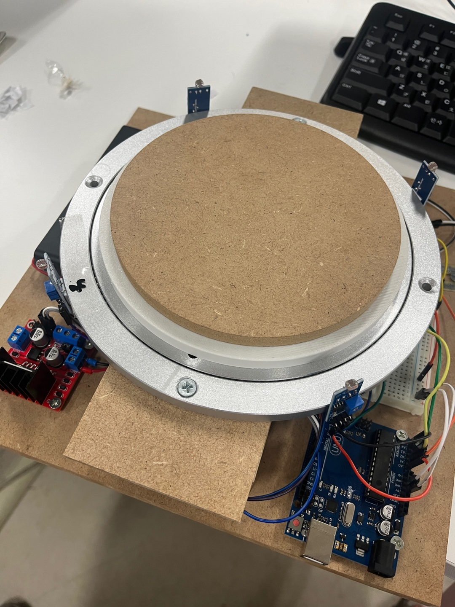
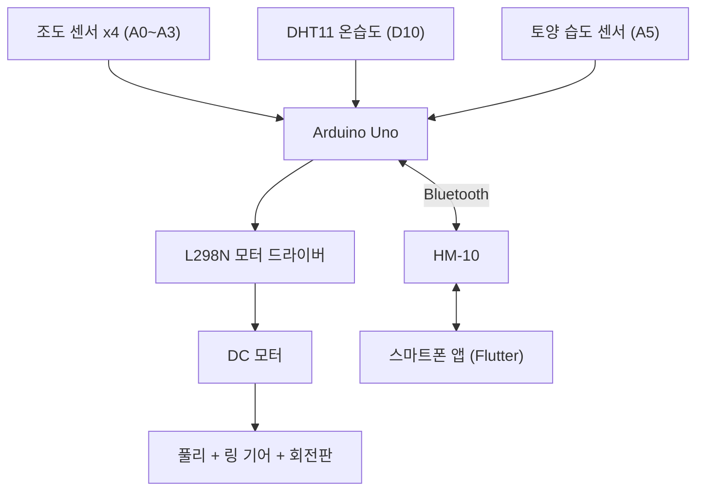
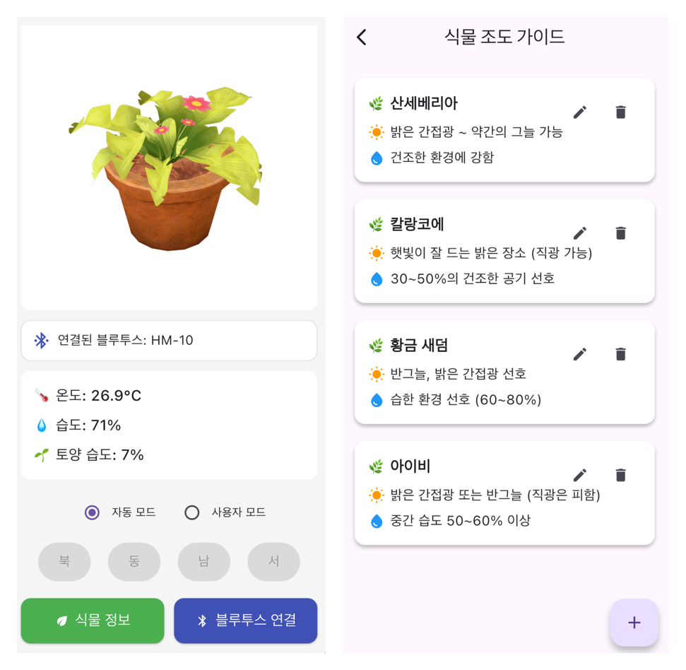
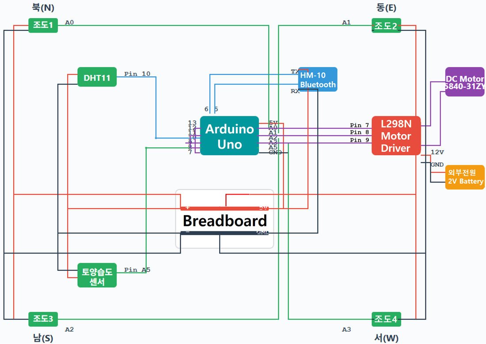
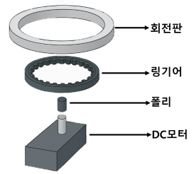
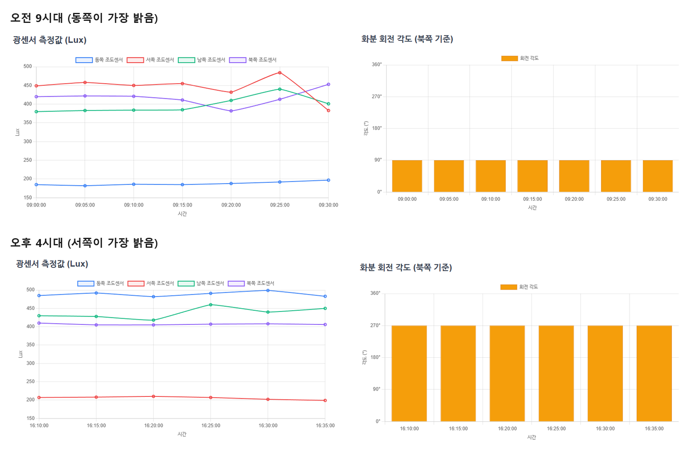

# S.P.I.N 스마트 회전 화분 (Smart Plant Illumination Navigator)

햇빛이 한쪽에서만 들어오는 실내에서도 식물이 골고루 빛을 받도록, **빛이 오는 방향을 찾아 스스로 회전하는 화분**입니다.
조도 센서 4개로 가장 밝은 방향을 찾아 DC 모터로 화분을 돌리고, 온도·습도·토양 습도를 **블루투스로 스마트폰 앱에 실시간으로 전송**합니다.
한남대학교 컴퓨터공학과 캡스톤디자인(2025년 1학기)에서 만들었고, 이 프로젝트로 쓴 논문이 KCI 등재지에 게재되었습니다.



## 시연 영상

[](docs/demo.mp4)

이미지를 누르면 전체 영상을 볼 수 있습니다. 손전등으로 한쪽을 비추면 조도 센서가 빛을 인식해 화분이 그쪽으로 회전하고, 앱에서 온도·습도·토양 습도를 확인하는 모습을 보여줍니다.

## 프로젝트 정보

| 항목 | 내용 |
|---|---|
| 기간 / 팀 | 2025년 3월 ~ 6월 / S.P.I.N (4명, 팀장) |
| 내 역할 | 하드웨어 구축(모터 선정, 링 기어 도면 제작·3D 프린팅), 디자인·기능 설계, 재료 탐색·구매, 아두이노 코드 일부 작성, 논문 집필(서론·관련 연구 조사 및 작성) |
| 논문 | 「실내 식물 성장을 위한 자동 회전 기반 스마트 화분 연구」, 스마트미디어저널 14(11), 2025.11, KCI 등재 · [KCI](https://www.kci.go.kr/kciportal/ci/sereArticleSearch/ciSereArtiView.kci?sereArticleSearchBean.artiId=ART003266230) · [DOI](https://doi.org/10.30693/SMJ.2025.14.11.158) |
| 사용 기술 | Arduino C++, 조도 센서, DHT11, 토양 습도 센서, HM-10(BLE), L298N 모터 드라이버, DC 모터, 3D 프린팅 (앱: Flutter) |

## 만든 이유

아파트나 오피스텔 같은 공동주택은 창문 방향이 고정되어 있어서 식물이 한쪽에서만 햇빛을 받기 쉽고, 그러면 생장이 한쪽으로 치우칩니다. 화분을 직접 돌려주면 되지만 바쁜 사람에게는 번거로운 일입니다.
그래서 사용자가 손대지 않아도 화분이 스스로 빛을 향해 돌아가고, 필요할 때는 앱으로 직접 조작할 수 있는 화분을 만들었습니다.

## 주요 기능

- **자동 모드 (기본)**: 동·서·남·북 4방향에 설치한 조도 센서 값을 13초마다 비교해 가장 밝은 방향으로 화분을 회전합니다. 조도 센서는 밝을수록 값이 낮게 나오므로 값이 가장 낮은 방향을 고릅니다.
- **사용자 모드**: 앱에서 동/서/남/북 중 원하는 방향을 선택하면 그 방향으로 화분이 회전합니다. 이 모드에서는 자동 회전이 꺼집니다.
- **환경 모니터링**: 온도·습도(DHT11)와 토양 습도(YL-69)를 1초마다 앱으로 전송합니다.
- **연결 끊김 처리**: 블루투스 연결이 끊기면 자동 모드로 돌아갑니다.
- **식물 정보 탭**: 앱에서 식물별 정보를 조회하고 추가·수정·삭제할 수 있습니다.

## 시스템 구조



앱과 아두이노는 줄 단위 텍스트로 통신합니다.

| 방향 | 메시지 | 설명 |
|---|---|---|
| 앱 → 아두이노 | `MODE:AUTO` / `MODE:MANUAL` | 자동 / 사용자 모드 전환 |
| 앱 → 아두이노 | `DIR:N` `DIR:E` `DIR:S` `DIR:W` | 원하는 방향으로 회전 |
| 아두이노 → 앱 | `temp:26.9,humid:71.0,soil:7` | 온도(℃), 습도(%), 토양 습도(%) |

펌웨어에는 개발 중 쓰던 회전 속도 설정 명령(`SPD:0`~`SPD:100`)도 남아 있지만, 최종 앱에서는 방향 선택만 사용합니다.

### 스마트폰 앱

앱은 팀원이 Flutter로 만들었습니다. HM-10 은 `flutter_blue_plus` 로 스캔하고 연결하며, 아두이노가 보내는 센서 문자열을 받아 화면에 표시하고, 모드와 방향 명령을 보냅니다. 홈 화면에서 온·습도와 토양 습도를 확인하고 모드와 방향을 선택하며, 식물 정보 화면에서 식물별 적정 환경을 관리합니다. 이 저장소는 펌웨어와 하드웨어 중심이라 앱 소스는 포함하지 않았습니다.




## 하드웨어

| 부품 | 모델 / 역할 |
|---|---|
| 제어 보드 | Arduino Uno |
| 조도 센서 모듈 | SZH-SSBH-011, 동·서·남·북 4방향 |
| 온습도 센서 | DHT11 |
| 토양 습도 센서 | YL-69 |
| 블루투스 모듈 | HM-10 (BLE 4.0) |
| 모터 드라이버 | L298N |
| 모터 | DC 모터 5840-31ZY (12V), 외부 전원 |
| 회전부 | 풀리, 링 기어, 회전판 |

### 회로도



### 회전부



DC 모터에 장착한 풀리가 링 기어를 돌리면, 링 기어에 결합된 회전판이 같은 방향으로 회전해 화분이 돕니다. 모터와 풀리는 구매했고, 링 기어는 풀리와 회전판에 맞춰 도면을 직접 제작한 뒤 3D 프린팅 대행 업체와 치수를 확인하며 출력했습니다.

위치를 알려 주는 센서 없이 DC 모터로 방향을 맞추기 위해, 기준 방향에서 각 방향까지 도는 시간을 측정해 그 시간만큼만 구동합니다. (코드에서는 90°에 24초) 회전판은 0°, 90°, 180°, 270° 네 방향만 가리킵니다.

### 핀 연결 (`smart_pot.ino` 기준)

| 부품 | 핀 |
|---|---|
| 조도 센서 (동/북/남/서) | A0 / A1 / A2 / A3 |
| 토양 습도 센서 | A5 |
| DHT11 | D10 |
| HM-10 (TX→6, RX←5), STATE | SoftwareSerial(6, 5), D11 |
| 모터 드라이버 ENA / IN1 / IN2 | D9 / D8 / D7 |

## 실험 결과

시스템을 시간대별로 배치해 조도 센서 값과 회전 각도를 약 30분간 5분 간격으로 측정했습니다. 조도 센서는 밝을수록 값이 낮게 나오므로, 그래프에서 가장 낮은 선이 가장 밝은 방향입니다.

- **오전 9시대**: 동쪽 센서 값이 가장 낮게(가장 밝게) 측정되었고, 화분은 북쪽 기준 90°(동쪽)로 회전해 유지되었습니다.
- **오후 4시대**: 서쪽 센서 값이 가장 낮게 측정되었고, 화분은 270°(서쪽)로 회전해 유지되었습니다.



## 폴더 구조

```
firmware/
├── smart_pot/                  # 최종 펌웨어 (자동/사용자 모드, 블루투스, 센서 전송)
└── tools/ldr_test/             # 조도 센서 값 확인용 테스트
docs/
├── demo.mp4                    # 시연 영상
└── images/                     # 사진, 회로도, 앱 화면, 실험 결과
```

## 실행해 보기

1. Arduino IDE 라이브러리 관리자에서 **DHT sensor library** (Adafruit)와 함께 필요한 **Adafruit Unified Sensor** 를 설치합니다.
2. 위 핀 표대로 배선하고 `firmware/smart_pot/smart_pot.ino` 를 업로드합니다.
3. HM-10 에 블루투스로 연결할 수 있는 앱에서 `MODE:MANUAL`, `DIR:E` 같은 명령을 보내 동작을 확인합니다. 시리얼 모니터(9600)에서 센서 값과 회전 로그를 볼 수 있습니다.
4. 조도 센서만 먼저 확인하려면 `firmware/tools/ldr_test` 를 사용하세요.

## 참고

- 사용 라이브러리: [DHT sensor library](https://github.com/adafruit/DHT-sensor-library)
- 관련 연구: 김성민 외, 「조도센서를 이용한 빛 추적 시스템」, 한국정보기술학회 2017 하계종합학술대회
